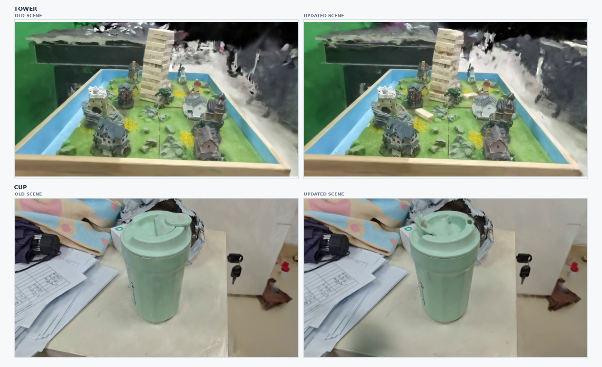
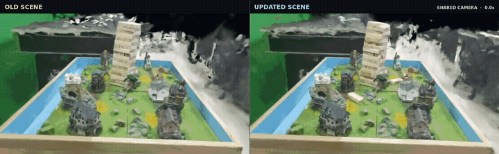
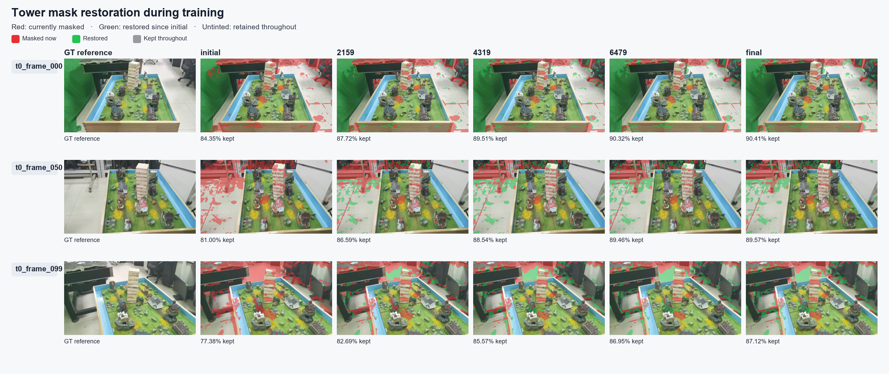
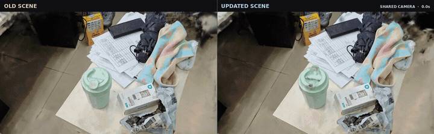
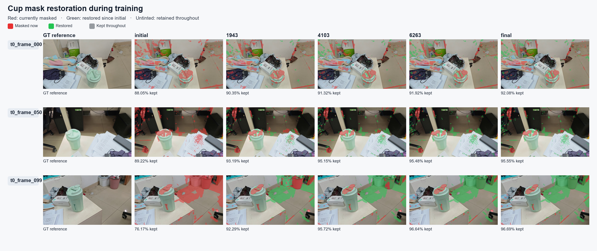
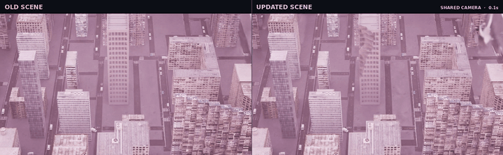
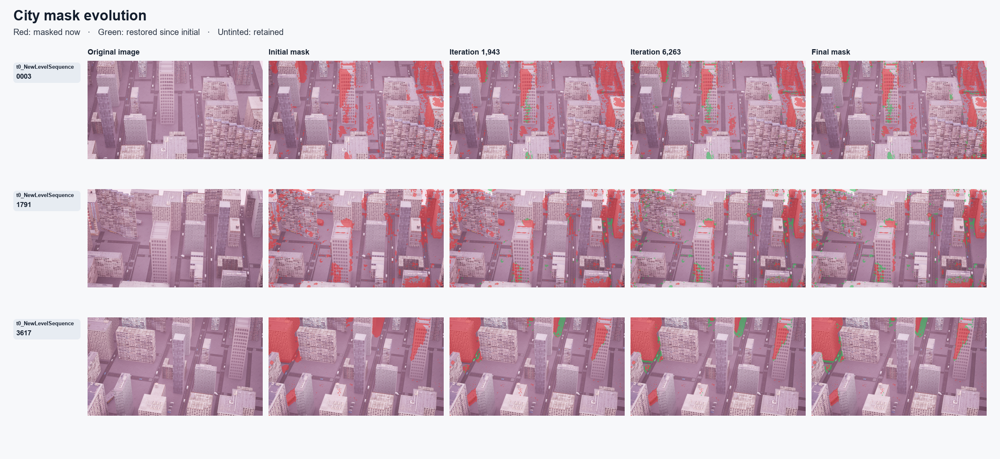

<h1 align="center">
  Cross-Temporal 3D Gaussian Splatting<br>
  for Sparse-View Guided Scene Update
</h1>

<p align="center">
  <strong>Zeyuan An</strong><sup>1</sup> ·
  <strong>Yanghang Xiao</strong><sup>1</sup> ·
  <strong>Zhiying Leng</strong><sup>1</sup> ·
  <strong>Frederick W. B. Li</strong><sup>2</sup> ·
  <strong>Xiaohui Liang</strong><sup>1,3,*</sup>
</p>

<p align="center">
  <sup>1</sup> Beihang University · <sup>2</sup> Durham University · <sup>3</sup> Zhongguancun Laboratory<br>
  <sup>*</sup> Corresponding author
</p>

<p align="center"><strong>AAAI 2026</strong></p>

<p align="center">
  <a href="https://doi.org/10.1609/aaai.v40i4.37217"></a>
  <a href="https://arxiv.org/abs/2512.00534"></a>
</p>

<p align="center">
  <a href="README.md">中文</a> · <a href="#results">Results</a> · <a href="#installation">Installation</a> · <a href="#data-preparation">Data</a> · <a href="#running">Run</a> · <a href="#citation">Citation</a>
</p>

<p align="center">
  <br>
  <em>Left: scene trained only on old-time images (Old); right: updated scene (Updated). Each pair is shown from the same viewpoint.</em>
</p>

## Overview

Cross-Temporal 3D Gaussian Splatting updates a scene from sparse views captured at a later time. The two-stage pipeline first builds confidence labels for existing views (BU, *before update*), then adapts a newly initialized Gaussian model using old and new views (DA, *during adaptation*). DA starts from the prepared `points3D.ply`, rather than resuming the BU model, and progressively restores supervision to old-view regions as their masks are updated. New views use full-image supervision.

Mask and label value **1** (white, 255 in PNG) is supervised; **0** is currently unsupervised. During DA, supervised pixels are retained and unsupervised pixels may be restored, so the supervised region grows over time.

## Results

### Tower

<p align="center">
  <a href="assets/showcase/tower_old_vs_updated.mp4"></a>
</p>

Click the preview to open the [full comparison video](assets/showcase/tower_old_vs_updated.mp4). The left shows the scene trained only on old-time images; the right shows the updated scene along the same camera trajectory.

<details>
<summary>Tower: mask evolution for three old-scene viewpoints</summary>

Red remains masked; green restores supervision.



[View 000](assets/showcase/masks/tower_t0_frame_000_large.png) · [View 050](assets/showcase/masks/tower_t0_frame_050_large.png) · [View 099](assets/showcase/masks/tower_t0_frame_099_large.png)

</details>

### Cup

<p align="center">
  <a href="assets/showcase/cup_old_vs_updated.mp4"></a>
</p>

Click the preview to open the [full comparison video](assets/showcase/cup_old_vs_updated.mp4). The left shows the scene trained only on old-time images; the right shows the updated scene along the same camera trajectory.

<details>
<summary>Cup: mask evolution for three old-scene viewpoints</summary>

Red remains masked; green restores supervision. The middle Cup stage comes from an independent rerun with the same settings.



[View 000](assets/showcase/masks/cup_t0_frame_000_large.png) · [View 050](assets/showcase/masks/cup_t0_frame_050_large.png) · [View 099](assets/showcase/masks/cup_t0_frame_099_large.png)

</details>

### City

<p align="center">
  <a href="assets/showcase/city_old_vs_updated.mp4"></a>
</p>

Click the preview to open the [full comparison video](assets/showcase/city_old_vs_updated.mp4). The left shows the scene trained only on old-time images; the right shows the updated scene along the same camera trajectory.

<details>
<summary>City: mask evolution for three old-scene viewpoints</summary>

Masks progress from the initial state through updates during training to the final state. Red remains masked; green restores supervision. All stages come from this training run.



[View 0003](assets/showcase/masks/city_t0_NewLevelSequence_0003_large.png) · [View 1791](assets/showcase/masks/city_t0_NewLevelSequence_1791_large.png) · [View 3617](assets/showcase/masks/city_t0_NewLevelSequence_3617_large.png)

</details>

## Installation

```bash
git clone https://github.com/ZeyuanAn/CrossTemporal3DGS.git
cd CrossTemporal3DGS
```

The training environment used WSL2 Ubuntu 22.04, Python 3.7.13, PyTorch 1.13.1+cu117, torchvision 0.14.1+cu117, and a CUDA GPU. Use a complete CUDA Toolkit 11.7 development installation, including `nvcc`, headers, and libraries, with a compatible host C/C++ compiler. PyTorch's CUDA runtime alone cannot build the extensions. Set `CUDA_HOME` to the actual Toolkit prefix.

For an isolated Python environment using venv and pip, follow the [installation guide](docs/INSTALL_PIP.md). The Conda setup below is run from the repository root:

```bash
conda env create -f environment.yml
conda activate cross_temporal_3dgs
export CUDA_HOME="${CUDA_HOME:-/usr/local/cuda-11.7}"
export PATH="$CUDA_HOME/bin:$PATH"
command -v nvcc
nvcc --version
gcc --version
python -c 'import torch; print(torch.__version__, torch.version.cuda)'
python -m pip install --no-build-isolation ./submodules/diff-gaussian-rasterization
python -m pip install --no-build-isolation ./submodules/simple-knn
```

Check that `nvcc --version` reports CUDA 11.7, `torch.version.cuda` reports `11.7`, and `CUDA_HOME` points to the same Toolkit as `PATH`. See NVIDIA's [CUDA 11.7 installation guide](https://docs.nvidia.com/cuda/archive/11.7.0/cuda-installation-guide-linux/index.html) and the [PyTorch previous-version matrix](https://docs.pytorch.org/get-started/previous-versions/). Optional package mirrors in China include [Tsinghua PyPI](https://pypi.tuna.tsinghua.edu.cn/simple), [Aliyun PyPI](https://mirrors.aliyun.com/pypi/simple/), and [USTC Anaconda](https://mirrors.ustc.edu.cn/anaconda/).

No checkpoints are included. BU's `evidence` initialization requires the [EfficientSAM ViT-T checkpoint](https://github.com/yformer/EfficientSAM/blob/main/weights/efficient_sam_vitt.pt): use **Download raw file** and pass the downloaded file with `--sam-checkpoint`. The `pixel` initialization does not require SAM.

## Data preparation

The dataset is distributed separately from the source code. [Download the five-scene dataset](https://github.com/ZeyuanAn/CrossTemporal3DGS/releases/download/v1.0.0/cross_temporal_5_scenes_public.zip). Choose an extraction parent directory; the archive contains a top-level `cross_temporal_5_scenes/` directory:

```bash
ZIP=/path/to/cross_temporal_5_scenes_public.zip
EXTRACT_PARENT=../cross_temporal_data
mkdir -p "$EXTRACT_PARENT"
unzip "$ZIP" -d "$EXTRACT_PARENT"
DATA_ROOT="$EXTRACT_PARENT/cross_temporal_5_scenes"
SCENE=tower
WORK_ROOT=../cross_temporal_work
mkdir -p "$WORK_ROOT"
```

Available scenes are `airpods`, `city`, `cup`, `keyboard`, and `tower`. A scene has this layout:

```text
cross_temporal_5_scenes/<scene>/
├── images/
├── mask/                 # marker filenames identify new-time views; pixels are not read
├── label/                # source labels, if present; each training copy starts empty
└── sparse/0/
    ├── cameras.bin       # or cameras.txt
    ├── images.bin        # or images.txt, paired with the cameras format
    └── points3D.ply      # prepared geometry in the shared camera coordinate frame
```

`t0` denotes old-time views and `t1` denotes new-time views. COLMAP camera and image files must be a matching binary or text pair. Undistorted cameras must use `PINHOLE` or `SIMPLE_PINHOLE`; the text camera reader supports `PINHOLE`, while the binary path supports both. Referenced image basenames must be in the root of `images/`, with stems unique ignoring case. Marker stems in `mask/` must match new-image stems with the same case; marker pixel contents are not used. Each `points3D.ply` vertex must contain `x, y, z`, `red, green, blue` (0–255), and `nx, ny, nz`; unknown normals may be zero. Cameras and the PLY must share a coordinate frame. The prepared `points3D.ply` must be in `sparse/0/`.

Typical data has 100 old training views, 8 new training views, and 4 new test views. By default, sorted new views at indices `0, 3, 6, ...` are held out. To set a custom test split, pass `--test-list` to `prepare_scene.py` with a UTF-8 file containing one new-view filename or stem per line. Keep at least one test view for evaluation and at least one new training view, then inspect the generated `split.json`.

Prepare a fresh isolated scene copy for every run. The destination and output paths must not already exist; use new names for later runs. The source dataset remains separate, while BU writes labels into the prepared copy.

## Running

### Smoke run

This runs each stage for three iterations at the default one-eighth input resolution. DA attempts mask updates at iterations 1 and 3, but the masks may not change.

```bash
python prepare_scene.py --source "$DATA_ROOT/$SCENE" --destination "$WORK_ROOT/scenes/${SCENE}_smoke"
python run_pipeline.py --scene "$WORK_ROOT/scenes/${SCENE}_smoke" --output "$WORK_ROOT/runs/${SCENE}_smoke" --gpu 0 --smoke --initial-mask-method pixel --mask-method pixel
```

### Full training

The recommended example uses evidence initialization for BU and pixel updates for DA. Download the checkpoint from the linked official weights page, or use the command below, then prepare a fresh scene copy:

```bash
mkdir -p "$WORK_ROOT/weights"
SAM_CHECKPOINT="$WORK_ROOT/weights/efficient_sam_vitt.pt"
curl -fL https://github.com/yformer/EfficientSAM/raw/refs/heads/main/weights/efficient_sam_vitt.pt -o "$SAM_CHECKPOINT"
python prepare_scene.py --source "$DATA_ROOT/$SCENE" --destination "$WORK_ROOT/scenes/${SCENE}_full"
python run_pipeline.py \
  --scene "$WORK_ROOT/scenes/${SCENE}_full" \
  --output "$WORK_ROOT/runs/${SCENE}_evidence_pixel" \
  --gpu 0 \
  --initial-mask-method evidence \
  --sam-checkpoint "$SAM_CHECKPOINT" \
  --sam-grid-size 8 --mask-analysis-width 640 \
  --mask-method pixel --stage2-iterations 7000
```

For a pixel/pixel run without SAM, prepare another fresh copy and use a new output path:

```bash
python prepare_scene.py --source "$DATA_ROOT/$SCENE" --destination "$WORK_ROOT/scenes/${SCENE}_pixel"
python run_pipeline.py \
  --scene "$WORK_ROOT/scenes/${SCENE}_pixel" \
  --output "$WORK_ROOT/runs/${SCENE}_pixel_pixel" \
  --gpu 0 --initial-mask-method pixel --mask-method pixel --stage2-iterations 7000
```

Defaults are a BU phase switch at iteration 3900, BU label generation at 5900, and 7000 DA iterations. DA updates masks when `iteration > 900` and `(iteration + 1) % 108 == 0`, first at iteration 971 and then every 108 iterations.

### Render and outputs

The output directory contains `run.json` and the BU/DA model directories. BU labels are written to `label/` in the prepared scene copy; final DA masks are written to `da/final_masks/`. The final DA point cloud is normally at `da/point_cloud/iteration_7000/point_cloud.ply`. The runner does not save terminal logs or run final evaluation by default. Use `--evaluate` to enable the DA final evaluation.

To render held-out views from the evidence/pixel run above, choose an output directory that does not already exist:

```bash
CUDA_VISIBLE_DEVICES=0 python evaluate_holdout.py \
  --model "$WORK_ROOT/runs/${SCENE}_evidence_pixel/da" \
  --scene "$WORK_ROOT/scenes/${SCENE}_full" \
  --output "$WORK_ROOT/runs/${SCENE}_evaluation" \
  --iteration 7000
```

Rendered test views are saved in `renders/` under the output directory. The first run may download pretrained weights. For a pixel/pixel run, set `--model` to `"$WORK_ROOT/runs/${SCENE}_pixel_pixel/da"`, `--scene` to `"$WORK_ROOT/scenes/${SCENE}_pixel"`, and choose a new output directory.

## License

The inherited Gaussian-Splatting code is subject to the non-commercial research/evaluation terms in [`LICENSE.md`](LICENSE.md). See [`THIRD_PARTY_NOTICES.md`](THIRD_PARTY_NOTICES.md) for third-party code, model, and dataset notices.

## Citation

```bibtex
@article{an2026crosstemporal,
  title   = {Cross-Temporal 3D Gaussian Splatting for Sparse-View Guided Scene Update},
  author  = {An, Zeyuan and Xiao, Yanghang and Leng, Zhiying and Li, Frederick W. B. and Liang, Xiaohui},
  journal = {Proceedings of the AAAI Conference on Artificial Intelligence},
  volume  = {40},
  number  = {4},
  pages   = {2327--2335},
  year    = {2026},
  doi     = {10.1609/aaai.v40i4.37217},
  eprint  = {2512.00534},
  archivePrefix = {arXiv}
}
```

The main strategy follows the paper, but mask detection methods, thresholds, and related details have been adjusted; therefore, this implementation is not identical to the paper version.
