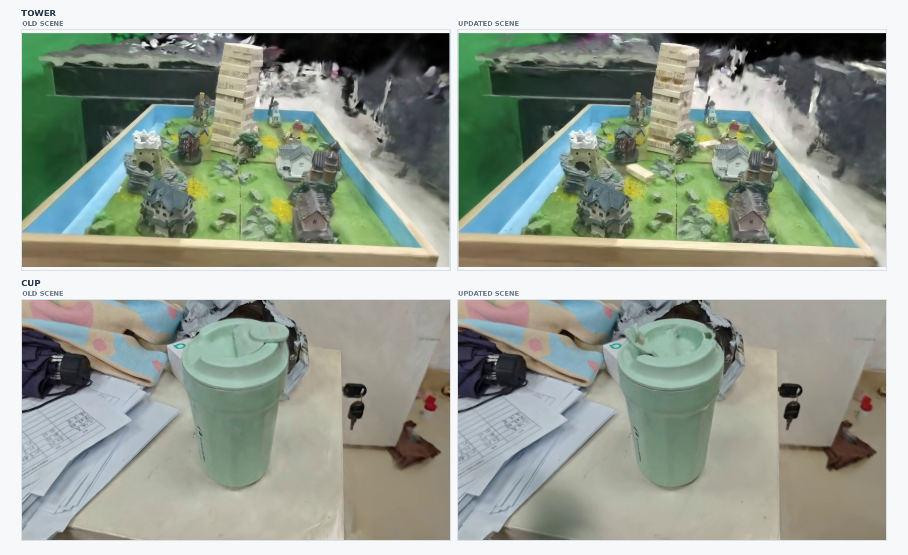
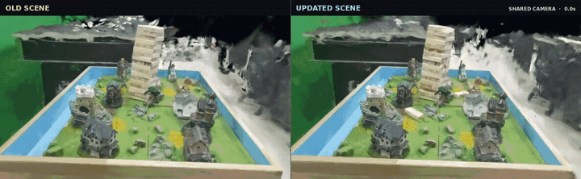
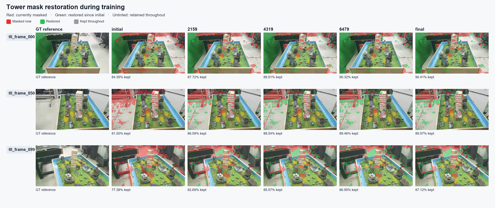
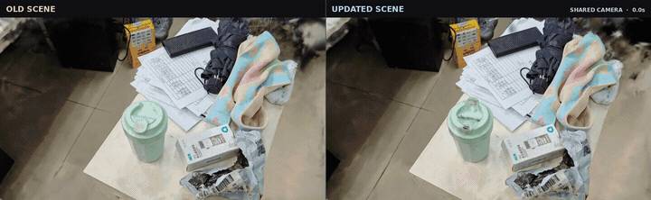
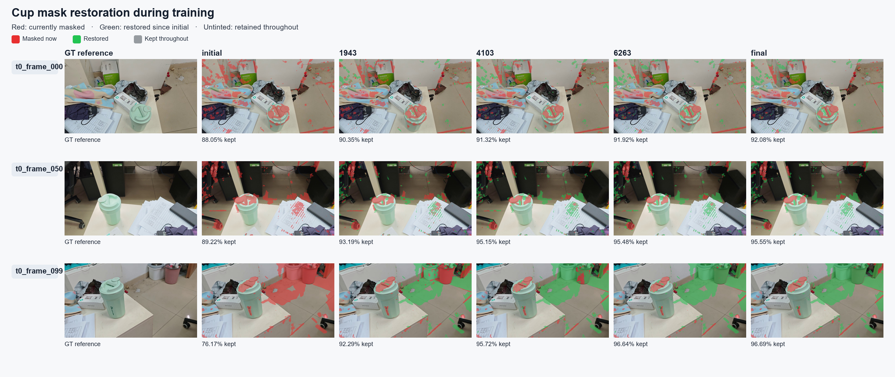
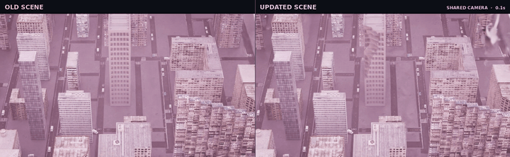
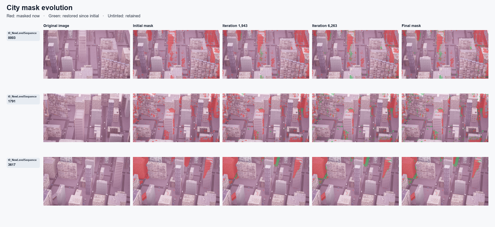

<h1 align="center">
  Cross-Temporal 3D Gaussian Splatting<br>
  for Sparse-View Guided Scene Update
</h1>

<p align="center">
  <strong>Zeyuan An</strong><sup>1</sup> ·
  <strong>Yanghang Xiao</strong><sup>1</sup> ·
  <strong>Zhiying Leng</strong><sup>1</sup> ·
  <strong>Frederick W. B. Li</strong><sup>2</sup> ·
  <strong>Xiaohui Liang</strong><sup>1,3,*</sup>
</p>

<p align="center">
  <sup>1</sup> Beihang University · <sup>2</sup> Durham University · <sup>3</sup> Zhongguancun Laboratory<br>
  <sup>*</sup> 通讯作者
</p>

<p align="center"><strong>AAAI 2026</strong></p>

<p align="center">
  <a href="https://doi.org/10.1609/aaai.v40i4.37217"></a>
  <a href="https://arxiv.org/abs/2512.00534"></a>
</p>

<p align="center">
  <a href="README.en.md">English</a> · <a href="#效果展示">效果展示</a> · <a href="#环境安装">环境安装</a> · <a href="#准备数据">数据准备</a> · <a href="#训练与输出">训练与输出</a> · <a href="#许可与引用">许可与引用</a>
</p>

<p align="center">
  <br>
  <em>左：仅用旧时刻图像训练的场景（Old）；右：更新后的场景（Updated）。每组画面采用相同视角。</em>
</p>

## 效果展示

### Tower

<p align="center">
  <a href="assets/showcase/tower_old_vs_updated.mp4"></a>
</p>

点击预览可打开[完整对比视频](assets/showcase/tower_old_vs_updated.mp4)。左侧为仅用旧时刻图像训练的场景，右侧为更新后的场景；两者沿同一轨迹展示。

<details>
<summary>Tower：三个视角的旧视角掩码演进</summary>

红色表示仍被屏蔽，绿色表示恢复监督。



[视角 000](assets/showcase/masks/tower_t0_frame_000_large.png) · [视角 050](assets/showcase/masks/tower_t0_frame_050_large.png) · [视角 099](assets/showcase/masks/tower_t0_frame_099_large.png)

</details>

### Cup

<p align="center">
  <a href="assets/showcase/cup_old_vs_updated.mp4"></a>
</p>

点击预览可打开[完整对比视频](assets/showcase/cup_old_vs_updated.mp4)。左侧为仅用旧时刻图像训练的场景，右侧为更新后的场景；两者沿同一轨迹展示。

<details>
<summary>Cup：三个视角的旧视角掩码演进</summary>

红色表示仍被屏蔽，绿色表示恢复监督。中间阶段来自相同设置下的一次独立重跑。



[视角 000](assets/showcase/masks/cup_t0_frame_000_large.png) · [视角 050](assets/showcase/masks/cup_t0_frame_050_large.png) · [视角 099](assets/showcase/masks/cup_t0_frame_099_large.png)

</details>

### City

<p align="center">
  <a href="assets/showcase/city_old_vs_updated.mp4"></a>
</p>

点击预览可打开[完整对比视频](assets/showcase/city_old_vs_updated.mp4)。左侧为仅用旧时刻图像训练的场景，右侧为更新后的场景；两者沿同一轨迹展示。

<details>
<summary>City：三个视角的旧视角掩码演进</summary>

掩码从初始状态经训练中的更新演进到最终状态。红色表示仍被屏蔽，绿色表示恢复监督；各阶段均来自本次实际训练。



[视角 0003](assets/showcase/masks/city_t0_NewLevelSequence_0003_large.png) · [视角 1791](assets/showcase/masks/city_t0_NewLevelSequence_1791_large.png) · [视角 3617](assets/showcase/masks/city_t0_NewLevelSequence_3617_large.png)

</details>

## 项目流程

Cross-Temporal 3DGS 使用两个阶段进行跨时间场景更新：

- **BU（before update）**：从场景的 `points3D.ply` 初始化模型，使用旧时刻 `t0` 与新时刻 `t1` 的训练视角训练，并生成逐图 `label/`。
- **DA（during adaptation）**：重新从场景 `points3D.ply` 初始化模型，读取 BU 标签进行训练，并迭代更新旧视角监督掩码。DA 不从 BU 模型继续训练。
- 新视角使用全图监督；掩码更新作用于旧视角。掩码值 `1`（PNG 白色）表示参与监督，值 `0`（PNG 黑色）表示暂不监督。更新只会保留或增加监督区域，不会减少。
- `--initial-mask-method` 选择 BU 标签生成方法：`evidence`、`pixel` 或 `block`。`--mask-method` 选择 DA 掩码更新方法：`pixel` 或 `block`。`evidence` 需另行准备 EfficientSAM 权重；`pixel` 不需要。

## 快速开始

### 环境安装

已验证环境使用 WSL2 Ubuntu 22.04、Python 3.7.13、PyTorch 1.13.1+cu117、torchvision 0.14.1+cu117 和 CUDA GPU。建议使用完整且匹配的 CUDA Toolkit 11.7。编译 CUDA 扩展需要 Toolkit 开发组件（包括 `nvcc`、headers 和库）；仅有 PyTorch CUDA runtime 不够。`CUDA_HOME` 示例路径应按实际安装位置调整。

可使用 Conda 环境文件安装，也可按[独立 venv / pip 指南](docs/INSTALL_PIP.md)操作：

```bash
conda env create -f environment.yml
conda activate cross_temporal_3dgs
export CUDA_HOME="${CUDA_HOME:-/usr/local/cuda-11.7}"
export PATH="$CUDA_HOME/bin:$PATH"
command -v nvcc
nvcc --version
python -c 'import torch; print(torch.__version__, torch.version.cuda)'
python -m pip install --no-build-isolation ./submodules/diff-gaussian-rasterization
python -m pip install --no-build-isolation ./submodules/simple-knn
```

请确认 `nvcc` 与 `torch.version.cuda` 均对应 CUDA 11.7，且主机 C/C++ 编译器和 GPU 驱动兼容。参考 [CUDA 11.7 Linux 安装指南](https://docs.nvidia.com/cuda/archive/11.7.0/cuda-installation-guide-linux/index.html)和 [PyTorch 历史版本安装组合](https://docs.pytorch.org/get-started/previous-versions/)。

### 准备数据

数据包与代码仓库分开提供：[下载五场景数据包](https://github.com/ZeyuanAn/CrossTemporal3DGS/releases/download/v1.0.0/cross_temporal_5_scenes_public.zip)。ZIP 内顶层目录为 `cross_temporal_5_scenes/`，场景目录包括 `airpods`、`city`、`cup`、`keyboard`、`tower`。

```bash
ZIP=/path/to/cross_temporal_5_scenes_public.zip
EXTRACT_PARENT=../cross_temporal_data
mkdir -p "$EXTRACT_PARENT"
unzip "$ZIP" -d "$EXTRACT_PARENT"
DATA_ROOT="$EXTRACT_PARENT/cross_temporal_5_scenes"
SCENE=tower
WORK_ROOT=../cross_temporal_work
```

每个场景的目录结构如下。`sparse/0/` 中的相机/图像文件应为二进制 `cameras.bin` + `images.bin` 或文本 `cameras.txt` + `images.txt` 配对格式，并包含预制 `points3D.ply`。

```text
cross_temporal_5_scenes/<scene>/
├── images/                 # COLMAP 图像文件引用的图片
├── mask/                   # 新视角标记文件；仅文件名用于划分
├── label/                  # 数据包可能附带的标签；训练副本会创建空目录
└── sparse/0/
    ├── cameras.bin         # 或 cameras.txt
    ├── images.bin          # 或 images.txt，与 cameras 文件格式配对
    └── points3D.ply
```

`t0` 表示旧时刻，`t1` 表示新时刻。相机需为去畸变的 `PINHOLE` 或 `SIMPLE_PINHOLE`；文本格式读取器只接受 `PINHOLE`，二进制格式支持两者。图像 basename 必须位于 `images/` 根目录，图像 stem（忽略大小写）须唯一。`mask/` 中标记文件的 stem 须与新视角图像 stem 大小写一致；标记文件像素不作为训练掩码。`points3D.ply` 须包含 `x, y, z`、`red, green, blue`（0–255）及 `nx, ny, nz` 顶点字段；未知法线可填零，点云与相机须在同一坐标系。

默认按名称排序的新视角划分测试视角：索引 `0, 3, 6, ...` 用于测试。可用 `prepare_scene.py --test-list` 指定 UTF-8 名单，每行写一个新视角文件名或 stem。测试集与新视角训练集都至少保留一张；准备后请检查 `split.json`。

### 隔离场景与短测

每次运行都先用 `prepare_scene.py` 创建独立副本，避免改写源数据或复用旧标签。目标副本目录及训练输出目录必须此前不存在；重跑时使用新的目录名。

```bash
mkdir -p "$WORK_ROOT/scenes" "$WORK_ROOT/runs"
python prepare_scene.py --source "$DATA_ROOT/$SCENE" --destination "$WORK_ROOT/scenes/${SCENE}_smoke"
python run_pipeline.py --scene "$WORK_ROOT/scenes/${SCENE}_smoke" --output "$WORK_ROOT/runs/${SCENE}_smoke" --gpu 0 --smoke --initial-mask-method pixel --mask-method pixel
```

`--smoke` 将 BU 和 DA 各缩短为 3 次迭代，DA 在第 1、3 次迭代尝试更新掩码，但不保证掩码发生有效变化；默认分辨率为原图的 1/8。短测用于检查流水线能否运行，不代表训练质量。

## 训练与输出

### 完整训练：evidence 初始化 + pixel 更新

`evidence` 初始化需要单独下载 [EfficientSAM 官方权重](https://github.com/yformer/EfficientSAM/blob/main/weights/efficient_sam_vitt.pt)，在页面点击 **Download raw file**，并将文件路径赋给 `SAM_CHECKPOINT`：

```bash
mkdir -p "$WORK_ROOT/weights" "$WORK_ROOT/scenes" "$WORK_ROOT/runs"
SAM_CHECKPOINT="$WORK_ROOT/weights/efficient_sam_vitt.pt"
# 将下载的 efficient_sam_vitt.pt 放到上面指定的路径
python prepare_scene.py --source "$DATA_ROOT/$SCENE" --destination "$WORK_ROOT/scenes/${SCENE}_full"
python run_pipeline.py \
  --scene "$WORK_ROOT/scenes/${SCENE}_full" \
  --output "$WORK_ROOT/runs/${SCENE}_evidence_pixel" \
  --gpu 0 \
  --initial-mask-method evidence \
  --sam-checkpoint "$SAM_CHECKPOINT" \
  --sam-grid-size 8 \
  --mask-analysis-width 640 \
  --mask-method pixel \
  --stage2-iterations 7000
```

### 完整训练：pixel 初始化 + pixel 更新

此模式无需 EfficientSAM 权重。它使用独立场景副本，可作为另一种完整训练配置：

```bash
python prepare_scene.py --source "$DATA_ROOT/$SCENE" --destination "$WORK_ROOT/scenes/${SCENE}_pixel"
python run_pipeline.py \
  --scene "$WORK_ROOT/scenes/${SCENE}_pixel" \
  --output "$WORK_ROOT/runs/${SCENE}_pixel_pixel" \
  --gpu 0 \
  --initial-mask-method pixel \
  --mask-method pixel \
  --stage2-iterations 7000
```

Runner 默认在 BU 训练到第 3900 次迭代时切换阶段，并在第 5900 次迭代生成标签；DA 默认训练 7000 次迭代。DA 掩码更新条件为 `iteration > 900` 且 `(iteration + 1) % 108 == 0`，首次更新在第 971 次迭代，此后每 108 次迭代更新。默认训练分辨率为输入原始分辨率。`--bu-threshold` 适用于 BU 的 `pixel` / `block` 初始化；`evidence` 使用自适应阈值。其他参数见 `python run_pipeline.py --help`。

BU/DA 模型与点云写入输出目录下的 `bu/` 和 `da/`，运行参数及状态保存在 `run.json`。BU 标签写入该次训练副本的 `label/`；DA 完成后旧训练视角掩码默认写入 `da/final_masks/`。最终点云通常位于 `da/point_cloud/iteration_7000/point_cloud.ply`。Runner 默认不执行最终评估，也不自动保存终端日志；日志文件请放在 `--output` 目录之外。

### 测试视角渲染

以下命令使用上面的 evidence/pixel 训练结果；`--output` 指定的目录必须此前不存在：

```bash
CUDA_VISIBLE_DEVICES=0 python evaluate_holdout.py \
  --model "$WORK_ROOT/runs/${SCENE}_evidence_pixel/da" \
  --scene "$WORK_ROOT/scenes/${SCENE}_full" \
  --output "$WORK_ROOT/runs/${SCENE}_evaluation" \
  --iteration 7000
```

测试视角渲染图保存在输出目录的 `renders/` 中。首次运行可能需要联网下载预训练权重。对于 pixel/pixel 训练，将 `--model` 改为 `"$WORK_ROOT/runs/${SCENE}_pixel_pixel/da"`、`--scene` 改为 `"$WORK_ROOT/scenes/${SCENE}_pixel"`，并使用新的输出目录。

## 许可与引用

根目录 [LICENSE.md](LICENSE.md) 包含继承的 Gaussian-Splatting 非商业研究/评估许可及其条件。第三方代码、模型权重和数据集说明见 [THIRD_PARTY_NOTICES.md](THIRD_PARTY_NOTICES.md)。

```bibtex
@article{an2026crosstemporal,
  title   = {Cross-Temporal 3D Gaussian Splatting for Sparse-View Guided Scene Update},
  author  = {An, Zeyuan and Xiao, Yanghang and Leng, Zhiying and Li, Frederick W. B. and Liang, Xiaohui},
  journal = {Proceedings of the AAAI Conference on Artificial Intelligence},
  volume  = {40},
  number  = {4},
  pages   = {2327--2335},
  year    = {2026},
  doi     = {10.1609/aaai.v40i4.37217},
  eprint  = {2512.00534},
  archivePrefix = {arXiv}
}
```

主要策略与论文一致，但 mask 检测方式、阈值等细节有调整，因而不完全等同论文版本。
